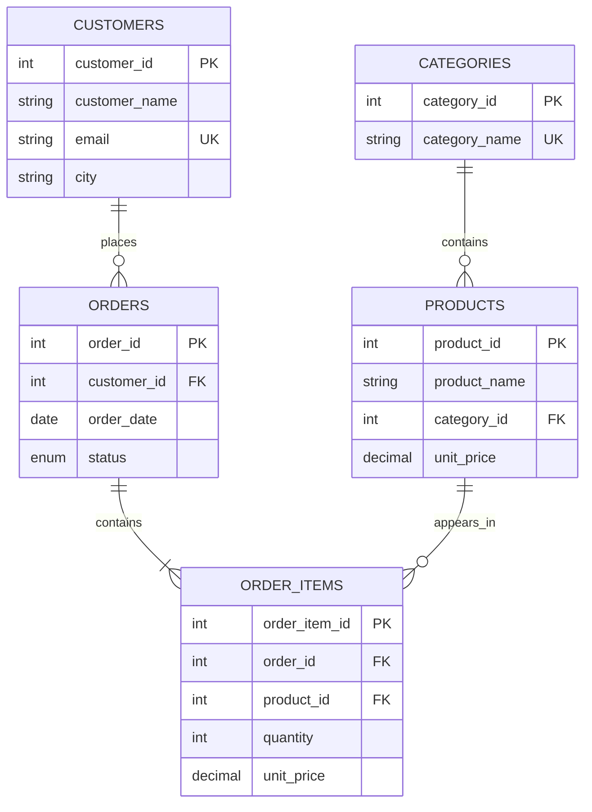

# Database Diagram

A customer can place many orders and a category can contain many products.
`order_items` resolves the many-to-many relationship between orders and products.
No cascading delete is used, so order history cannot be erased accidentally.
